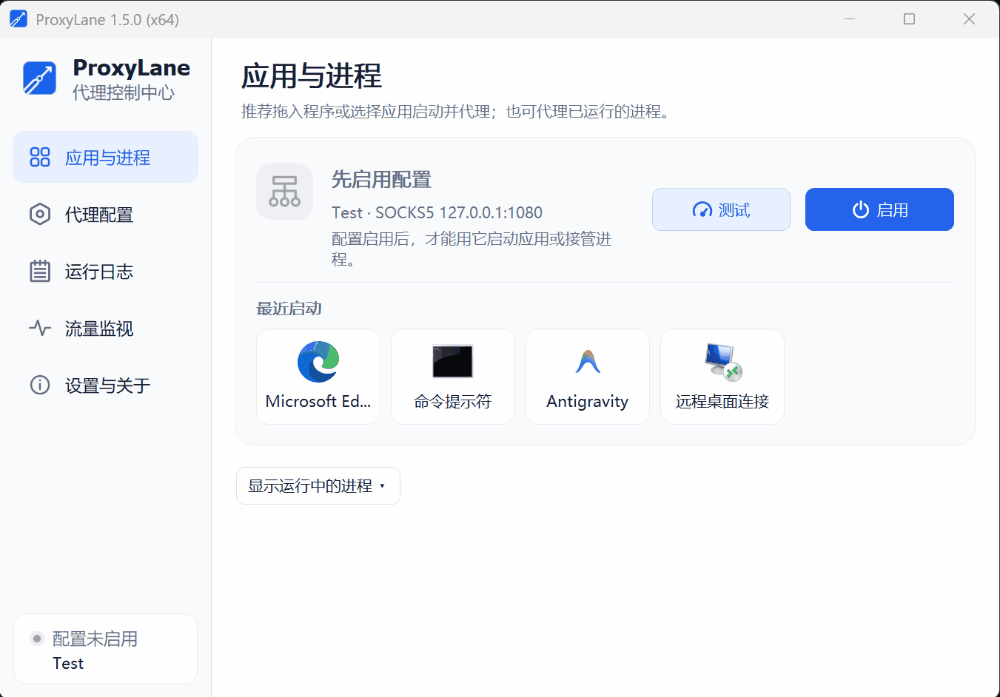

<h1 align="center">ProxyLane</h1>

<p align="center">
  <strong>Windows 应用进程级透明代理 · HTTPS / QUIC 流量解密</strong><br>
  免 TUN · 独立代理配置 · 子进程自动继承 · 流量录制与离线回放
</p>

<p align="center">
  欢迎来 <a href="https://linux.do/t/topic/2980923">Linux.do</a>、<a href="https://v2ex.com/t/1242151">V2EX</a> 社区讨论
</p>

<p align="center">简体中文 | <a href="README_EN.md">English</a></p>

---

ProxyLane 让指定 Windows 应用使用独立的代理配置，无需修改系统全局代理或安装内核驱动。它通过用户态进程注入与网络 API Hook 实现代理，并可让子进程继承设置。

主体代理功能兼容 **Windows XP 至 Windows 11**，提供 Win32 与 x64 组件。

常规 `ProxyLane-版本-Windows.zip` 仅面向 x86/x64 Windows，不包含 ARM64 组件。ARM64 使用独立的 `ProxyLane-版本-Windows-ARM64.zip` 开发测试包；其功能范围和未完成的实机验收见包内说明。

除了代理，也可以用它分析应用流量：查看 HTTP/1.1、HTTP/2、HTTP/3 请求响应、DNS 和 Raw／Hex 数据，解密 HTTPS 与 QUIC v1，并录制后离线查看。选择 `NOPROXY` 即可在不使用外部代理的情况下监视流量。

## 操作演示



## 快速开始

1. 完整解压发行包，保留程序与 DLL 在同一目录。64 位 Windows 建议运行 `ProxyLane64.exe`。
2. 在 **代理设置** 中选择或新建配置，填写代理类型、服务器地址、端口及认证信息。
3. 按需启用 **代理 TCP**、**代理 UDP** 和 **代理子进程**，点击 **测试当前设置** 检查连接，再点击 **启动代理**。
4. 到 **应用与进程** 页面选择应用启动，或直接拖入程序、快捷方式。也可以选中已运行的进程，点击 **代理所选进程**。
5. 在运行日志中检查接管结果，按需进入 **流量监视** 查看连接和数据。

优先从 ProxyLane 启动应用。对已运行进程进行接管时，已有网络连接可能仍不走代理；需要完整代理时，请先保存工作并退出应用，再从 ProxyLane 启动。

### 代理类型与规则

- **SOCKS5**：支持 TCP 和 UDP；UDP 需要服务端支持。
- **HTTP**：通过 HTTP/1.1 CONNECT 代理 TCP，不支持 UDP 代理。旧 HTTP10、HTTP11 配置读取时自动映射为 HTTP，保留其他设置，保存时统一写成 HTTP；旧 HTTP10 配置的连接协议相应升级为 HTTP/1.1 CONNECT。
- **SSH**：通过 SSH 加密隧道代理 TCP，支持密码或私钥认证；服务器需允许 TCP 端口转发，不支持 UDP 代理。可单独使用或加入代理链。需使用 64 位主程序，最低支持 Windows 10 / Server 2016 x64；详见 [SSH 代理](#ssh-代理)。
- **NOPROXY**：直接连接目标，用于监视、解密等不需要外部代理的场景，无需填写服务器地址和端口。
- **子进程规则 / 目标规则**：默认代理所有子进程（需启用“代理子进程”）和网络地址。需要限定范围时，可按界面示例填写匹配规则。
- **禁止 UDP / 阻止 IPv6**：按需限制相应流量。“禁止 UDP”优先于 UDP 代理或接管选项。

### DNS 解析方式

- **本地解析**：使用本机的 DNS 解析结果。
- **远程解析**：把目标域名交给代理服务器，由代理决定连接哪个 IP。
- **经代理加密解析**：ProxyLane 经当前业务选定的代理链连接 DoH 服务，得到 IP 后，再经同一代理链访问该 IP。需要支持可选模块的 x64 主程序及随附的 `ProxyLaneMitm64.dll`，无需开启流量解密或安装 CA；不支持 NOPROXY。

DoH 必须填写 HTTPS 服务地址和明确的**连接 IP（引导 IP）**，例如 `https://dns.google/dns-query` 与 `8.8.8.8,8.8.4.4`。连接使用指定 IP，TLS 证书和 HTTPS Host 仍按服务地址校验。支持标准 `application/dns-message` POST、HTTP/1.1；不跟随重定向。失败会明确记录并终止请求，不回退到本地 DNS、旧的远程域名解析或 TCP/UDP 53。代理节点自身的地址解析沿用既有行为；若也要避免首个代理节点的本地解析，请为它配置 IP。

结果按 DNS TTL 缓存在主进程内，同时考虑 CNAME TTL 和 HTTP 缓存限制，最多缓存一小时（只缩短、不延长 TTL）；TTL 为零不缓存。同域名、地址类型、DoH 配置及代理链的并发请求共享一次查询，取消一个连接不影响其他等待者。缓存不落盘，停止代理后清空。不同配置、代理链、主进程实例及代理测试彼此隔离。普通 UDP 仍受既有传输限制：只有单个 SOCKS5 代理支持 UDP。

每个 DoH 引导 IP 的代理隧道建连最多等待 12 秒，包括 SSH 服务器连接该 IP 的等待；失败后可尝试下一个引导 IP。查询总超时仍为 60 秒，多引导 IP 的每次完整尝试仍最多 15 秒。

DoH 的网络读写由套接字事件驱动，查询完成后通过主进程消息循环通知等待任务并回包；缓存命中、本地拒绝和重试也主动通知，不用 25 毫秒定时器轮询完成。保留每秒的超时/空闲检查，不负责推进 DoH 通信。

此模式还默认接管受管应用、命中代理规则的普通 TCP/UDP 53 DNS 请求，内网和公网 DNS 一视同仁。应用 Hook 将请求交给 PL 主进程，通过所选代理链执行 DoH，再返回完整 DNS 响应；不实际访问原 DNS 服务器，不新增本机 53 端口监听。保留普通 DNS 记录、请求 ID 和剩余 TTL。等价报文（除 ID 外相同）按 DoH 配置和代理链合并，TCP/UDP 可共享查询；无答案、错误或截断响应不缓存。私网 IPv4（10.0.0.0/8、172.16.0.0/12、192.168.0.0/16）的 `in-addr.arpa` PTR 查询由 PL 本地返回 REFUSED，不发送 DoH、不回退本地 DNS；公网 PTR 保持 DoH 查询。非法报文、区域传送和动态更新明确拒绝；DoH 传输失败返回 SERVFAIL，不回退普通 DNS。

UDP DNS 回包保留实际的本地中继来源地址和端口，不伪装成原 DNS 服务器。校验原 DNS 来源地址的客户端不支持；不通过接收 API、异步完成或 UDP `getpeername` Hook 改写地址来兼容它们。此技术当前不认为可靠和稳定，项目不采用，禁止未经用户明确批准重新引入；参见 [项目约束](AGENTS.md)。

**禁止 UDP 具有最高优先级，UDP DNS 同样被禁止，没有 DNS 例外。** 未禁止 UDP 时，UDP DNS 接管不依赖“代理 UDP”开关，可通过 HTTP、SSH 或代理链使用 DoH，因为对外传输是 HTTPS。TCP DNS 不受“禁止 UDP”影响；软件是否重试 TCP 由软件决定。显式直连规则、回环地址、mDNS/LLMNR、应用自行使用的 DoH/DoT 不在本次接管范围内；禁止 IPv6 的行为保持不变。

旧 INI 和旧分享码可由新版读取；DoH 配置及暂未启用的自定义 DoH 设置使用通用的 `proxylane://profile/v3/` 分享码，能够无损表达的其他配置沿用 v1/v2。切换 DNS 模式后请重新启动被代理应用，避免继续使用应用已有的 DNS 结果。

### 代理命令行工作区

启动代理并勾选 **代理子进程**，再从 ProxyLane 启动 `cmd.exe`。也可以打开新的命令提示符，在进程列表中选中它并点击 **代理所选进程**。

此后从该窗口启动的 Git、Python、`pip`、`curl` 等程序，可按子进程规则继承代理设置，无需逐个添加：

```bat
curl https://example.com
git clone https://github.com/example/project.git
pip install requests
python script.py
```

### 浏览器已在后台运行

Edge、Chrome 可能在关闭窗口后继续驻留后台，从 ProxyLane 启动时会复用已有进程，导致代理未生效。检测到可能存在这种情况时，ProxyLane 会发送托盘通知；点击通知可查看相关进程，并选择 **结束进程**、**代理进程** 或 **查看相关进程**。

建议先保存浏览器中的工作，检查列出的进程，结束后再从 ProxyLane 启动浏览器。直接点击 **代理进程** 仍可能保留不走代理的已有连接。通知是否显示受 Windows 通知设置影响。

## 流量监视与解密

监视与解密需要支持这些功能的 **64 位主程序**，可处理 32 位和 64 位目标应用。

### 查看流量

1. 启动代理并接管目标应用。只想监视时，选择 `NOPROXY`，按需启用 **接管 TCP / UDP**；需要 UDP 流量时取消 **禁止 UDP**。
2. 进入 **流量监视**，开始监视，再让应用发起请求。
3. 按进程筛选会话，查看请求响应、正文、DNS 查询，或切换到 Raw／HexView 查看原始数据。

普通流量监视不需要安装 CA。停止监视会停止新增采集，已有连接继续转发。

### 解密 HTTPS 与 QUIC

1. 打开 **流量监视 → 解密选项**，按需启用 **解密 HTTPS** 或 **解密 QUIC**。
2. 首次使用按提示安装当前用户 CA，然后保存选项并开始监视。
3. 让目标应用重新建立连接。修改 QUIC 解密选项后，请完全退出并重新启动目标应用。

HTTPS 解密不限于 443 端口；QUIC 支持 v1，可查看 HTTP/3，以及其他受支持协议的流和报文数据。使用独立信任库、证书固定或不支持的协议时，解密可能不可用，兼容性也会随应用版本变化。目前不支持 QUIC 0-RTT 转发、连接迁移、WebTransport 和 CONNECT-UDP。

### 录制与离线查看

在 **流量监视 → 选项 → 录制选项** 中启用 **保留录制文件**，设置保存目录、容量和磁盘预留空间，再开始监视。保存目录和容量设置会记住，但每次启动 ProxyLane 后需要重新勾选保留录制。达到容量上限或磁盘空间不足时会停止录制，不删除旧数据。

停止监视后，选择 **选项 → 查看已有录制…** 并打开录制目录，即可离线筛选会话、查看请求响应和 Raw／Hex 数据，无需启动代理。录制目录附有格式说明，也可以交给其他工具或智能体分析。

## 配置管理与分享

### 分享单个代理配置

在代理设置页选择 **配置操作 ▾ → 复制完整配置**，将整行 `proxylane://profile/…` 配置码发给对方。对方复制后选择 **配置操作 ▾ → 粘贴配置**，即可填入相关选项，再保存或启动代理；代理运行中需点击 **保存并应用** 才生效。

配置码包含当前界面的未保存修改、用户名、**密码和 PSK**，以及网络选项和过滤规则。配置码没有加密，请仅分享给可信的人。全局选项、解密设置、CA、录制文件和最近应用不包含在内。

### 分享码版本与未来兼容

`v3` 是通用的可扩展分享格式，不是 DoH 专用版本。Base64URL 内的 JSON 包含 `required_features`（所需能力）和 `profile`（完整配置）；可选的 `metadata` 对象只允许承载不影响执行的说明信息，接收方忽略它，重新分享时不保留。当前导出能力标识为 `dns.doh.v2`（含普通 DNS 报文接管）和 `ssh.private-key.v1`，由导出器根据实际配置生成，导入器核对声明与配置是否一致。此前的 `dns.doh.v1` 仍可导入，并采用当前 DoH 模式的默认行为；新导出保持 v3 前缀，通过 v2 能力标识使不支持接管的旧版明确拒绝导入。

| 收到的配置 | 粘贴时的处理 |
| --- | --- |
| 有效的 v1、v2 或本轮开发版的平铺 DoH v3 | 继续读取；平铺 v3 仅作兼容读取，新导出使用统一封装 |
| v3，所需能力和字段都支持 | 校验通过后填入界面，不自动启用 |
| v3，包含未来能力，例如 `dns.doh.v3` | 拒绝导入，列出不支持的能力，提示更新 |
| 未知业务字段，包括值为 `false` 的新选项 | 拒绝导入，指出字段；不静默丢弃 |
| 缺少能力声明、声明与内容不一致、未知枚举值或非法字段类型 | 拒绝导入，不改写当前界面、配置或私钥文件 |
| 未知格式版本，例如 v4 | 提示格式版本不受支持 |

导出时仅在可以保留配置含义和自定义值时沿用 v1/v2；暂时关闭 DoH 不会丢掉用户填写的服务地址及引导 IP。未配置自定义 DoH 值的旧分享码，其编辑器预填值固定为 `https://dns.google/dns-query` 和 `8.8.8.8, 8.8.4.4`，不会随以后程序预设变化而改变。

后续增加选项通常仍使用 v3。开发时需同步更新 `ProfileShareCodec.h` 的已知字段、字段/枚举校验、所需能力推导与支持清单，以及界面导入、持久化和往返测试；冻结的旧格式字段集合不得扩充。新增影响执行或需要保留的设置应声明对应能力，接收方不认识就明确拒绝。已有能力标识的含义不得改变；不兼容的新语义使用新的能力标识，例如 `dns.doh.v3`。只有整体封装或基础解释规则不能兼容时，才升级分享格式版本。程序版本号不代替这些检查。以上规则针对分享码，不增加新版 INI 给旧程序使用的兼容保证。

### 导入全部配置

选择 **设置与关于 → 导入全部配置…**，可导入其他目录或版本的 `ProxyLane.ini`，包括其中的全部配置和最近应用记录。

导入前先停止代理、测试和监视，并关闭本次接管的应用。确认后，程序会先在原 INI 旁创建带时间标识的备份，再替换整个 INI 并重启；导入或重启失败时尝试恢复原配置。未保存修改会丢失；证书、录制等外部文件不会随配置复制，需要自行迁移。

配置下拉列表会在展开时刷新，方便多个实例共享同一配置文件；刷新不会覆盖当前编辑内容。

配置菜单中的 **新建配置** 可创建独立草稿；保存后加入列表。**认证与加密（可选）** 合并为一个展开入口，有认证信息或启用加密时自动展开；折叠不关闭功能，也不会清空密码。进程列表支持按名称、PID、路径过滤，以及“仅看已接管”，筛选使用已有快照，不随输入重新枚举进程。

配置位置只由 EXE 同目录的 `portable.flag` 文件决定，空文件即可：有标志时使用同目录的 `ProxyLane.ini`，没有则使用 `%LOCALAPPDATA%\ProxyLane\ProxyLane.ini`，不读写注册表。仅有同目录 INI 不会启用便携模式；旧版用户若要继续使用它，请创建 `portable.flag`。**设置与关于** 显示实际路径，提供“改用程序目录配置”或“改用用户目录配置”，以及导入、导出。切换只创建或删除标志文件并重启，不复制、移动或覆盖任何已有 INI；目标没有 INI 时由首次启动创建默认配置。需要沿用其他配置时请自行导入。独立测试版本应使用带 `portable.flag` 的目录，避免共享正式配置。

不提供日常自动备份或独立的恢复入口；仅完整配置导入保留原有的导入前备份和失败恢复。配置保存使用临时文件校验后替换，写入失败保留原配置及未保存修改。导出包含密码和 PSK，不打包引用的外部文件。检查更新由用户手动触发，在后台访问 https://10000.download/api/tools/proxylane/release 查询最新正式发布（下载站缓存 10 分钟）。发现新版后打开下载站工具页，由用户选择下载，不自动安装；客户端无需直连 GitHub。设置与关于页提供下载站入口。


## SSH 代理

选择 `SSH` 协议，填写服务器地址、端口（通常为 22）和用户名，再选择密码或私钥认证。私钥支持 RSA、ECDSA、Ed25519 的 OpenSSH / PEM / PKCS#8 格式，含加密私钥；加密文件需填写私钥口令，文件需小于 16 KiB。暂不支持 PPK、Agent 或交互式认证。支持 TCP `direct-tcpip` 转发，服务器必须允许端口转发；可单独使用，也可作为 SOCKS5 / HTTP / SSH 混合链中任意位置的节点，不支持 UDP。

导入的私钥保存到当前用户 `%LOCALAPPDATA%\ProxyLane\keys\`，profile 的 `SshKeyFile` 只保存文件名引用，原文件移动或删除后仍可使用；加密私钥保留原加密内容，认证口令沿用配置文件中的保存方式。多个实例使用私钥内容的 SHA-256 命名、跨进程锁及原子发布，同一私钥复用文件，不同私钥不互相覆盖。删除或替换 profile 不自动删除共享私钥。

“复制完整 profile”仍包含私钥及口令，可用旧格式表达时使用 `proxylane://profile/v2/`，同时包含 DoH 等扩展设置时使用 v3；粘贴时自动保存到接收方的本地 `keys` 目录并建立引用。取消粘贴不会写入文件；私钥缺失时测试及复制会明确报错。单独备份 INI 时，应同时备份 `keys` 目录。旧的内联私钥配置可加载到本地目录，下一次保存时移除 INI 内的私钥内容。没有扩展设置的普通密码配置仍使用兼容的 v1 分享格式。

认证时从本地文件读取受限大小的私钥快照，使用 libssh2/OpenSSL 原生内存接口解析和签名，结束后清除快照；profile 仍只保存文件引用。此方式也支持 Unicode 路径，不需要私钥解析补丁。

首次点击测试时，会显示服务器的 SHA256 主机指纹；通过可信渠道核对并确认后再测试，最后保存并应用。指纹不匹配时拒绝连接，不发送登录密码。指纹以 `SshHostKey` 保存在配置中，密码沿用配置文件的明文保存方式。

C++ 管理按需创建的 SSH session，同一事件线程中相同前置链路、账号、认证方式、密码/私钥/口令和指纹的连接复用认证，每条业务 TCP 使用独立通道。测试会话独立建立，测试结束、失败或取消后立即回收，不保留复用。每 15 秒发送需要回复的 SSH keepalive；约 60 秒收不到服务端数据时使会话失效，后续新连接重新认证。现有 TCP 流不能透明恢复，需应用重新连接。业务会话在最后一条业务连接关闭后最多保留 30 分钟，期间可复用；多层 SSH 链按业务连接统一计时，内部隧道和 keepalive 不延长空闲期限。停止代理会立即关闭业务会话。

同一 session 可以同时等待多个通道打开确认，慢目标不会阻塞后续目标的打开。每个 session 最多保留 32 个未完成的打开操作，额外请求排队；单个请求约 60 秒超时，仅使该业务连接失败。取消或超时后仍保留协议清理状态，收到迟到确认时关闭对应通道，该状态也计入上限。

SSH 后端为独立的 `ProxyLaneSsh64.dll`，仅在使用 SSH 时加载，最低支持目标是 Windows 10 / Server 2016 x64；32 位应用可以通过 64 位主程序使用。OpenSSL 后端支持 RSA / ECDSA / Ed25519 主机密钥、Curve25519 密钥交换及 AES-GCM。

## gonc TLS-PSK 加密传输

在 SOCKS5 或 HTTP 配置的 **加密模式** 中选择 `gonc TLS-PSK`，填写远端 gonc 服务的地址、端口及相同的 PSK，无需在本机另开 gonc 客户端。

SOCKS5 支持加密 TCP 和 UDP，HTTP 仅支持 TCP。若远端同一端口需要同时接受 SOCKS5 和 HTTP，可启用 `-http`，例如：

```bat
gonc -e ":s5s -u -http" -l -k -psk YOUR_PSK -tls 1083
```

请将 `YOUR_PSK` 替换为自己的密钥。支持 TLS 1.3，并兼容 TLS 1.2 服务端。PSK 明文保存在 `ProxyLane.ini` 中，请妥善保管配置文件。

## 兼容性与界面语言

- 主体代理功能兼容 Windows XP 至 Windows 11，提供 Win32 与 x64 组件。
- 32 位主程序及 Windows XP / Server 2003 不支持流量监视、解密和 gonc 加密传输。
- 受支持的 64 位主程序可为 32/64 位应用提供上述功能；具体应用能否接管和解密取决于其兼容性。
- 内置简体中文和英文，默认跟随系统语言。可在 **关于与语言** 页面切换，下次启动时生效。

## 编译

### 环境准备

- Visual Studio 2019，安装 C++ 桌面开发及 MFC 组件。
- Visual C++ `v141_xp` 工具集和 Windows 7.1A SDK，用于主程序与 Hook DLL。
- `v142` 工具集和 Windows 10 SDK，用于测试项目。
- CMake 3.15+、`tar`、`v142` 和 Windows 10 SDK，用于 x64 SSH 后端。
- Rust MSVC 工具链，确保 `rustup` 和 `cargo` 在 PATH 中；MITM 模块使用固定版本 `1.88.0`。

在项目根目录准备 Rust 工具链：

```powershell
rustup toolchain install 1.88.0-x86_64-pc-windows-msvc
rustup target add x86_64-pc-windows-msvc
```

### 构建主程序

打开 `src/ProxyLane.sln`，选择 `Release`，分别构建 `Win32` 和 `x64`。也可在 Visual Studio Developer PowerShell 中，从项目根目录执行：

```powershell
msbuild .\src\ProxyLane.sln /m /p:Configuration=Release /p:Platform=Win32
msbuild .\src\ProxyLane.sln /m /p:Configuration=Release /p:Platform=x64
```

主程序及运行所需 DLL 输出到 `bin/`。x64 Release 的构建后步骤会调用 Rust 构建脚本，生成安全传输与 MITM 组件；首次构建需要下载依赖，耗时较长。

### SSH 后端依赖

libssh2 以官方 1.11.1 为基础，并应用 `third_party/libssh2/concurrent-channel-open.patch`；补丁在 [threatexpert/libssh2](https://github.com/threatexpert/libssh2) 的开发分支维护。目录中同时保留配套公开头文件和原始许可证。`scripts/build-ssh.ps1` 下载并校验官方源码包 SHA256，在忽略入库的 `build/deps` 下按补丁哈希隔离源码与构建缓存，再应用补丁；不依赖开发者本机的相邻仓库。`src/ProxyLaneSsh` 的 CMake 封装将 OpenSSL `libcrypto` 和 CRT 静态链接到 DLL，不需要额外 OpenSSL / VC 运行库 DLL。首次构建由 `scripts/prepare-openssl.ps1` 从 nuget.org 自动下载预编译的 `openssl-native 3.5.9`（约 128 MiB），按 `third_party/openssl/dependency.json` 中固定的 SHA256 校验并缓存；后续复用缓存。无需安装 OpenSSL、Perl、NASM、NuGet 或 .NET SDK，也无需账号。离线构建可预先放置同一包到 `build/deps/openssl-native.3.5.9.nupkg`。只使用 x64 / v142 / MT 的静态 libcrypto 和头文件；来源及签名核验记录见 `third_party/openssl/UPSTREAM.txt`。

x64 Release 构建只在 DLL / 构建标记缺失或依赖版本、脚本、封装源码变化时执行脚本；普通主工程改动跳过此步骤。已有源码缓存时不下载，已有对象文件时增量编译。需要手工重建后端可运行 `powershell -ExecutionPolicy Bypass -File .\scripts\build-ssh.ps1`。首次构建需要联网，之后可用缓存离线构建。发布脚本把 libssh2 许可证合并到统一的 `LICENSE`。

本地 SSH 集成测试需要 Python 和 Paramiko >= 3.5（测试 AES-GCM）：`powershell -ExecutionPolicy Bypass -File .\tests\run-ssh-transport-tests.ps1 -Full`。它在回环地址运行临时服务器，不使用系统账号；会扣住一个 OPEN 的服务器确认，验证后续 OPEN 在同一 session 上先确认并传输数据。测试也验证成功、失败和取消后的会话释放，以及多层 SSH 链清理；完整测试还包含约三分钟的通道超时、失联及空闲复用等待。30 分钟回收边界、重新计时和时钟回绕由单元测试验证。

### 单独构建 Rust 组件

```powershell
powershell -ExecutionPolicy Bypass -File .\scripts\build-secure-transport.ps1
powershell -ExecutionPolicy Bypass -File .\scripts\build-mitm.ps1
```

输出分别为 `bin/ProxyLaneSecureTransport64.dll` 和 `bin/ProxyLaneMitm64.dll`。MITM 脚本还会将命令行辅助工具输出到 `build/tools/`。`src\build-secure-transport.bat` 是安全传输脚本的快捷入口，仅构建 64 位安全传输 DLL。

### 测试与翻译检查

```powershell
powershell -ExecutionPolicy Bypass -File .\tests\run-tests.ps1
powershell -ExecutionPolicy Bypass -File .\scripts\check-locales.ps1
```

测试脚本会构建并运行 Win32/x64 单元测试。翻译位于 `src/ProxyLane/locales/zh-CN.json` 和 `en-US.json`，两份文件必须保持相同的键集合；修改后需重新构建主程序。语言资源已嵌入 EXE，无需单独分发。

## 打包发行版

构建完整的 Win32/x64 Release 及两个 Rust DLL 后，在项目根目录执行：

```powershell
powershell -ExecutionPolicy Bypass -File .\scripts\package-release.ps1
```

脚本检查主程序与 Hook DLL 的版本是否一致，生成 `dist/ProxyLane-版本-Windows.zip`，并输出 SHA-256。可用 `-OutputDirectory D:\releases` 指定输出目录。

发行包包含双架构主程序和 Hook DLL、64 位安全传输与 MITM DLL、中英文 README，以及汇总第三方声明的 `LICENSE`。发行包不包含活动配置文件，首次运行自动生成 Test 和 Direct 默认配置，升级解压不会覆盖用户的 INI；测试程序和命令行辅助工具不进入发行包。

## 项目结构

| 目录 | 内容 |
| --- | --- |
| `src/ProxyLane` | MFC 桌面界面与应用逻辑 |
| `src/ProxyLaneHook`、`src/remotecode` | 进程注入与网络 Hook |
| `src/ProxyLaneSecureTransport` | 加密代理传输 |
| `src/ProxyLaneMitm`、`src/ProxyLaneProtocol` | 流量解密与协议解析 |
| `tests` | 自动化测试与测试工具 |
| `examples` | 示例配置 |
| `scripts` | 构建、检查与打包脚本 |
