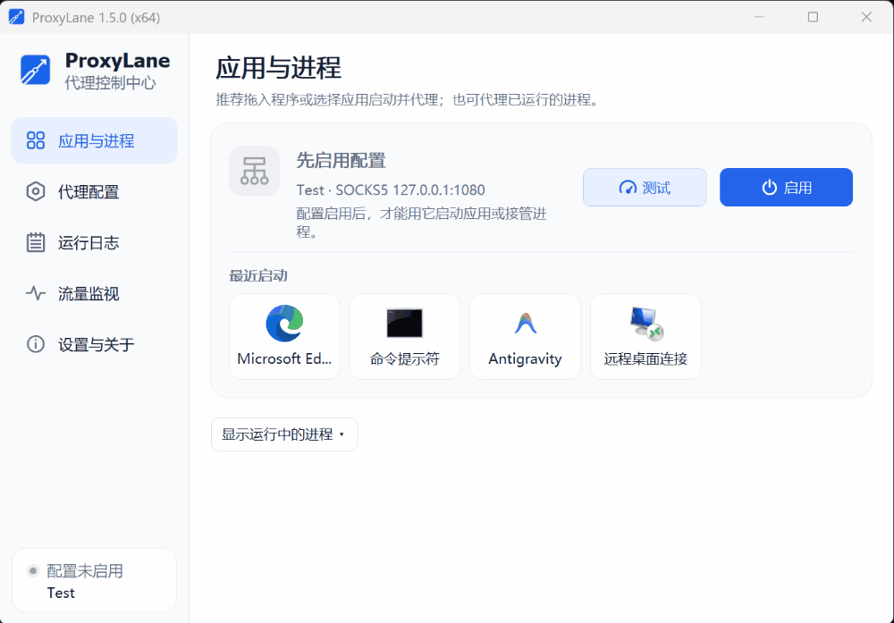

<h1 align="center">ProxyLane</h1>

<p align="center">
  <strong>Transparent per-process proxy for Windows · HTTPS / QUIC traffic decryption</strong><br>
  No TUN required · Separate proxy settings · Automatic child-process inheritance · Traffic recording and offline playback
</p>

<p align="center">
  Join the community discussion on <a href="https://linux.do/t/topic/2980923">Linux.do</a> and <a href="https://v2ex.com/t/1242151">V2EX</a>
</p>

<p align="center"><a href="README.md">简体中文</a> | English</p>

---

ProxyLane gives selected Windows applications their own proxy settings, supporting single proxies and multi-hop proxy chains without changing the system-wide proxy or installing a kernel driver. It uses user-mode process injection and network API hooks, and can pass proxy settings to child processes.

ProxyLane supports **x86/x64 systems running Windows XP through Windows 11**, as well as **Windows 11 ARM64**.

If your computer runs Windows 11 ARM64, select the `ProxyLane-version-Windows-ARM64.zip` release package when downloading. The ARM64 host does not yet support browser-specific QUIC policy intervention. See the [ARM64 notes](https://github.com/threatexpert/ProxyLane/blob/main/docs/README_ARM64.md) for details.

It also helps inspect application traffic: view HTTP/1.1, HTTP/2 and HTTP/3 requests and responses, DNS and Raw/Hex data, decrypt HTTPS and QUIC v1, and save recordings for offline viewing. Select `NOPROXY` to monitor traffic without an external proxy.

## Usage Demo



## Quick Start

1. Extract the package for your architecture, keeping executables and DLLs together. Run `ProxyLane64.exe` on x64 Windows, `ProxyLane.exe` on 32-bit Windows, or `ProxyLaneARM64.exe` on Windows 11 ARM64.
2. Under **Proxy Settings**, select or create a profile and enter the proxy type, server address, port and credentials.
3. Enable TCP proxying, UDP proxying and **Proxy child processes** as needed. Click **Test Current** to check the connection, then **Start Proxy**.
4. Under **Apps and Processes**, choose an app to launch, or drop an executable or shortcut into ProxyLane. To attach to a running app, select its process and click **Proxy Selected Processes**.
5. Check the runtime log for the result. Open **Traffic Monitor** to inspect connections and data.

Prefer launching applications through ProxyLane. Attaching to a running process may leave existing connections outside the proxy. For complete coverage, save your work, exit the application and launch it through ProxyLane again.

### Proxy Types and Rules

- **SOCKS5**: TCP and UDP; UDP requires server support.
- **HTTP**: TCP through HTTP/1.1 CONNECT, without UDP proxying. Legacy HTTP10 and HTTP11 profiles load as HTTP with other settings preserved, and are saved as HTTP. Legacy HTTP10 profiles therefore switch to HTTP/1.1 CONNECT.
- **SSH**: TCP through an encrypted SSH tunnel, with password or private-key authentication. The server must allow TCP port forwarding; UDP proxying is not supported. Use SSH alone or as a proxy-chain node. Requires the 64-bit host on Windows 10 / Server 2016 x64 or later; see [SSH Proxy](#ssh-proxy).
- **NOPROXY**: direct connections for monitoring and decryption without an external proxy. No server address or port is needed.
- **Child-process / target rules**: by default, all child processes (with **Proxy child processes** enabled) and all network destinations are proxied. To limit the scope, follow the matching examples in the interface.
- **Block UDP / Block IPv6**: restrict the corresponding traffic as needed. Blocking UDP takes priority over UDP proxying or capture.

### DNS Resolution

- **Local resolution** uses the computer's DNS results.
- **Remote resolution** passes the destination hostname to the proxy, which chooses the IP.
- **Encrypted DNS via Proxy** obtains destination IPs through the selected business proxy chain, then connects to those IPs through the same chain. Requires a supported x64 host and the bundled `ProxyLaneMitm64.dll`; traffic decryption and CA installation are not required. NOPROXY is not supported.

Provide an HTTPS endpoint and explicit **connection (bootstrap) IPs**, for example `https://dns.google/dns-query` and `8.8.8.8,8.8.4.4`. Connections use those IPs while TLS certificates and the HTTPS Host are validated against the endpoint. Standard `application/dns-message` POST over HTTP/1.1 is supported; redirects are rejected. Failure terminates the request with a log message, without falling back to local DNS, proxy-side hostname resolution or TCP/UDP port 53. Proxy-node address resolution retains its existing behavior; configure the first proxy with an IP to avoid local resolution of that node too.

Results are cached in host memory according to DNS TTL, CNAME TTL and HTTP cache restrictions, capped at one hour without extending any TTL. Zero-TTL answers are not cached. Concurrent queries with the same hostname, address family, DoH settings and proxy chain share one lookup; cancelling one connection does not cancel other waiters. Cache entries are not persisted and are cleared when the proxy stops. Different settings, chains, host instances and proxy tests remain isolated. Ordinary UDP remains limited to a single SOCKS5 proxy.

Establishing a proxy tunnel to each DoH bootstrap IP has a 12-second timeout, including an SSH server opening the target connection; failure may advance to the next bootstrap IP. The overall query deadline remains 60 seconds, and each full attempt with multiple bootstrap IPs remains limited to 15 seconds.

DoH I/O is driven by socket events. Completion notifies waiting tasks through the host message loop; cached answers, local refusals and retries also use notifications rather than 25 ms completion polling. One-second deadline/idle checks remain and do not advance DoH I/O.

This mode also intercepts ordinary TCP/UDP DNS requests on port 53 from managed applications whose traffic selects a proxy, for both private and public DNS destinations. The hook hands the query to the PL host, which sends it as DoH through the selected chain and returns the full DNS response. It never contacts the original resolver or opens a local port-53 listener. Record types, transaction IDs and remaining TTLs are preserved. Equivalent packets (identical except for ID) share queries across TCP/UDP within the same DoH configuration and chain. Negative, empty and truncated responses are not cached. PTR queries in `in-addr.arpa` for private IPv4 addresses (10/8, 172.16/12, 192.168/16) receive a local REFUSED response without DoH or local-DNS fallback; public PTR queries still use DoH. Invalid queries, zone transfers and updates are rejected; DoH transport failures return SERVFAIL without plain-DNS fallback.

UDP DNS replies retain the actual local relay source address and port. Clients requiring the original resolver source are unsupported. Do not rewrite addresses through receive APIs, asynchronous completion hooks or UDP `getpeername`. This technique is currently considered insufficiently reliable and stable and is not adopted; explicit user approval is required before reconsidering it. See [project constraints](AGENTS.md).

**Block UDP takes priority, including UDP DNS; there is no DNS exception.** When UDP is allowed, DNS interception works even with Proxy UDP off and can use HTTP, SSH or proxy chains because its upstream transport is HTTPS. TCP DNS is unaffected by Block UDP; whether an application retries with TCP is up to that application. Explicit direct routes, loopback, mDNS/LLMNR and application-managed DoH/DoT are outside this interception scope. Block IPv6 retains its existing behavior.

Existing INI files and sharing codes remain readable by the new version. DoH profiles, including inactive custom DoH preferences, use the generic `proxylane://profile/v3/` format; other profiles retain v1/v2 when they can be represented without losing settings. Restart proxied applications after changing DNS modes so they do not continue using previously resolved addresses.

### Proxy a Command-Line Workspace

Start the proxy with **Proxy child processes** enabled, then launch `cmd.exe` through ProxyLane. Alternatively, open a new Command Prompt, select its process and click **Proxy Selected Processes**.

Programs launched from that window, such as Git, Python, `pip` and `curl`, can inherit the proxy settings according to your child-process rules:

```bat
curl https://example.com
git clone https://github.com/example/project.git
pip install requests
python script.py
```

### Browsers Running in the Background

Edge and Chrome may keep running after their windows close. Launching them through ProxyLane can reuse an existing process, leaving traffic outside the proxy. When ProxyLane detects a possible case, it sends a tray notification. Click it to inspect the related processes and choose **End processes**, **Proxy processes** or **View related processes**.

Save your browser work and check the listed processes before ending them, then restart the browser through ProxyLane. Using **Proxy processes** directly may leave existing connections outside the proxy. Windows notification settings can affect whether the notification appears.

## Traffic Monitoring and Decryption

Monitoring and decryption require a supported **64-bit host**, which can handle both 32-bit and 64-bit target applications.

### Inspect Traffic

1. Start the proxy and hook the target application. For monitoring without an external proxy, select `NOPROXY` and enable TCP/UDP capture as needed. Disable **Block UDP** if you need UDP traffic.
2. Open **Traffic Monitor**, start monitoring, then make requests in the application.
3. Filter sessions by process and inspect requests, responses, bodies and DNS queries, or use Raw/HexView for raw data.

Ordinary traffic monitoring does not require a CA. Stopping monitoring stops new capture while existing connections keep forwarding.

### Decrypt HTTPS and QUIC

1. Open **Traffic Monitor → Decryption options** and enable HTTPS or QUIC decryption as needed.
2. Install the current-user CA when prompted, save the options and start monitoring.
3. Make the target application establish new connections. After changing QUIC decryption options, fully exit and restart the application.

HTTPS decryption is not limited to port 443. QUIC v1 support includes HTTP/3 and stream or datagram data from other supported protocols. Private trust stores, certificate pinning and unsupported protocols may prevent decryption; compatibility also varies by application version. QUIC 0-RTT forwarding, connection migration, WebTransport and CONNECT-UDP are not currently supported.

### Record and View Offline

Enable **Keep recording files** under **Traffic Monitor → Options → Recording options**, choose a directory, capacity and disk reserve, then start monitoring. The directory and limits are remembered, but recording must be enabled again after restarting ProxyLane. Capture stops when its capacity or disk-space limit is reached without deleting old data.

After stopping monitoring, choose **Options → View saved recording…** and open a recording directory. You can filter sessions and inspect requests, responses and Raw/Hex data without starting the proxy. Each directory includes a format guide for use with other tools or AI agents.

## Profile Management and Sharing

### Share One Proxy Profile

Choose **Actions ▾ → Copy full profile** on the settings page and send the complete `proxylane://profile/…` line. The recipient copies it and selects **Actions ▾ → Paste profile** to fill the settings, then saves or starts the proxy. If the proxy is already running, click **Save & Apply** for the new settings to take effect.

The code includes current unsaved edits, username, **password and PSK**, network options and filtering rules. It is not encrypted, so share it only with trusted recipients. Global options, decryption settings, CA material, recordings and recent applications are not included.

### Share Format Versions and Future Compatibility

`v3` is a generic extensible format, not a DoH-specific version. Its Base64URL JSON envelope contains `required_features` and `profile`. An optional `metadata` object may contain only non-behavioral information; it is ignored and not preserved on export. Current capability identifiers are `dns.doh.v2` (including DNS-packet interception) and `ssh.private-key.v1`. The exporter derives them from the settings; the importer verifies that the declaration matches the profile. Earlier `dns.doh.v1` sharing codes remain readable and acquire the current DoH mode defaults. New exports retain the v3 prefix and require `dns.doh.v2`, so older importers reject the unsupported behavior rather than silently losing it.

| Incoming code | Import behavior |
| --- | --- |
| Valid v1, v2, or the flat DoH v3 from the development build | Readable; flat v3 is a read-only migration path, while new v3 exports use the envelope |
| v3 with supported capabilities and fields | Validate and populate the editor, without activating the profile |
| Future capability, such as `dns.doh.v3` | Reject and list unsupported capabilities |
| Unknown behavioral field, including a new option set to `false` | Reject and identify the field; never silently discard it |
| Missing/mismatched capability declaration, unknown enum value or invalid field type | Reject before changing the editor, profile or key files |
| Unknown envelope version, such as v4 | Report an unsupported format version |

Exports retain v1/v2 only when settings and custom values can be preserved. Disabling DoH does not discard custom URLs or bootstrap IPs. For old codes without custom DoH preferences, the editor defaults are frozen at `https://dns.google/dns-query` and `8.8.8.8, 8.8.4.4`, independently of future application presets.

New settings normally stay on v3. Developers must update the known-field and value validation rules, capability derivation and support registry in `ProfileShareCodec.h`, editor import, persistence and round-trip tests together. Never expand the frozen legacy field vocabulary. New execution or preservation requirements must declare a capability; receivers that do not support it reject the code. Never reinterpret an existing capability identifier: incompatible semantics need a new identifier, such as `dns.doh.v3`. Bump the envelope version only for incompatible envelope or foundational interpretation changes. Application version numbers are not a substitute for these checks. These rules apply to sharing codes, not new-INI compatibility with old executables.

### Import All Settings

Choose **Settings & About → Import all…** to import a `ProxyLane.ini` from another directory or version, including all profiles and recent application records stored in it.

First stop the proxy, tests and monitoring, and close applications hooked by this instance. After confirmation, ProxyLane backs up the current configuration, replaces the entire INI and restarts. Unsaved edits are lost. External files such as certificates and recordings must be moved separately.

The profile dropdown refreshes when opened to reflect changes made by other instances sharing the file. Refreshing preserves current edits.

## SSH Proxy

Select `SSH`, enter the server address, port (usually 22) and username, then choose password or private-key authentication. RSA, ECDSA and Ed25519 keys in OpenSSH / PEM / PKCS#8 format under 16 KiB are supported, including encrypted keys with a passphrase. PPK, agents and keyboard-interactive authentication are not supported yet. TCP `direct-tcpip` forwarding requires server permission. SSH can be used alone or at any position in mixed SOCKS5 / HTTP / SSH chains; UDP is not supported.

Imported keys are managed in the current user's `%LOCALAPPDATA%\ProxyLane\keys\` folder. The profile stores only a filename reference in `SshKeyFile`; moving or deleting the original import file does not affect it. Encrypted keys retain their encrypted contents; passphrases continue to use the existing configuration storage. Content-based SHA-256 names, a cross-process lock and atomic publication let multiple instances reuse identical keys without overwriting different keys. Deleting or replacing a profile never automatically deletes shared keys.

Copy Complete Profile includes the key and passphrase in a `proxylane://profile/v2/` code when legacy representation is sufficient, or v3 when combined with DoH or other extended settings. Pasting writes the key into the recipient's local keys folder and creates its reference; cancelling a paste writes nothing. Missing keys produce explicit test/copy errors. An INI-only backup must include the keys folder separately. Previous inline-key profiles can be loaded into local storage; their next save removes the embedded key from the INI. Password profiles without extended settings retain the compatible v1 share format.

Authentication reads a bounded snapshot from the local key file and uses libssh2/OpenSSL's native memory API for parsing/signing, then erases the snapshot. Profiles still store only file references. This also supports Unicode paths without a private-key parsing patch.

Test first to discover the SHA256 host fingerprint. Verify it through a trusted channel before confirming, then test again and save/apply. An unexpected host key is rejected before authentication. The fingerprint is stored as `SshHostKey`; passwords retain the existing plaintext profile storage format.

C++ manages demand-created sessions. Connections on the same event thread reuse authentication when their entire route prefix, credentials and host key match; each TCP stream gets its own channel. Tests create isolated sessions and release them on completion, failure or cancellation, without caching. Keepalives request a reply every 15 seconds. About 60 seconds without incoming server data invalidates the session; a subsequent new connection authenticates again. Broken TCP streams require application reconnection and cannot resume transparently. Business sessions are retained for up to 30 minutes after the last business connection closes and can be reused during that period. Nested SSH hops share the business idle period; internal tunnels and keepalives do not extend it. Stopping the proxy closes its business sessions immediately.

Multiple channel opens can await server confirmation on the same session; a slow target does not serialize later opens. Each session admits at most 32 unfinished opens and queues excess requests. An individual open times out after about 60 seconds without failing healthy channels. Cancelled/timed-out operations retain cleanup state until a late confirmation is closed or a rejection arrives, and count against this limit.

The experimental ARM64 package also includes `ProxyLaneSshARM64.dll`, cross-built but awaiting ARM64 device validation; see [ARM64 package notes](docs/README_ARM64.md).

`ProxyLaneSsh64.dll` is loaded only for SSH, with Windows 10 / Server 2016 x64 as the minimum support target. A 64-bit host can serve 32-bit applications. The OpenSSL backend supports RSA / ECDSA / Ed25519 host keys, Curve25519 key exchange and AES-GCM.

## gonc TLS-PSK Secure Transport

For SOCKS5 or HTTP, select `gonc TLS-PSK` under **Transport** and enter the remote gonc server address, port and matching PSK. No separate local gonc client is needed.

SOCKS5 supports encrypted TCP and UDP; HTTP supports TCP only. To accept both SOCKS5 and HTTP on the same server port, enable `-http`, for example:

```bat
gonc -e ":s5s -u -http" -l -k -psk YOUR_PSK -tls 1083
```

Replace `YOUR_PSK` with your own key. TLS 1.3 is supported with TLS 1.2 server compatibility. The PSK is stored as plaintext in `ProxyLane.ini`, so keep the configuration file secure.

## Compatibility and Interface Languages

- Core proxy features support Windows XP through Windows 11, with Win32 and x64 components.
- The 32-bit host and Windows XP / Server 2003 do not support traffic monitoring, decryption or gonc secure transport.
- A supported 64-bit host provides these features for 32-bit and 64-bit applications; hooking and decryption depend on application compatibility.
- Simplified Chinese and English are included. The default follows the system language; changes under **About & Language** take effect after restarting ProxyLane.

## Building

For a new fork, start with the [complete build guide](docs/BUILDING_EN.md) ([简体中文](docs/BUILDING.md)). Import `vs2019-intel.vsconfig` for Intel-only builds, which need no ARM64 tools or Clang; use the full `.vsconfig` when including ARM64. Also install the documented Rust/Python tools. The standard entry works in ordinary PowerShell, discovers VS, checks prerequisites, builds incrementally and runs basic checks:

```powershell
powershell -NoProfile -ExecutionPolicy Bypass -File scripts/build-release.ps1 -CheckEnvironmentOnly
powershell -NoProfile -ExecutionPolicy Bypass -File scripts/build-release.ps1 -Package
# Build and package Intel and ARM64; discover Clang on PATH or in its default directory
powershell -NoProfile -ExecutionPolicy Bypass -File scripts/build-release.ps1 -Architecture All -Package
```

Intel products go to `bin/`, ARM64 to `bin/ARM64/Release/`, ZIPs/checksums to `dist/`, and logs/build records to `build/release/`. Caches are preserved. Individual entry points follow.

### Requirements

- Visual Studio 2019 with Desktop development with C++ and MFC components.
- Visual C++ `v141_xp` toolset and Windows 7.1A SDK for the application and Hook DLLs.
- `v142` toolset and Windows 10 SDK for the test project.
- CMake 3.15+, `tar`, `v142` and Windows 10 SDK for the x64 SSH backend.
- Rust MSVC toolchain, with `rustup` and `cargo` on PATH. Secure transport and MITM both use pinned version `1.88.0`.
- Python 3.8+, Git and `tar` for release checks and dependency preparation. ARM64 additionally needs v142 ARM64 ATL/MFC and Clang; see the complete guide.

Prepare the Rust toolchain from the repository root:

```powershell
rustup toolchain install 1.88.0-x86_64-pc-windows-msvc
rustup target add x86_64-pc-windows-msvc --toolchain 1.88.0-x86_64-pc-windows-msvc
```

### Build the Application

Open `src/ProxyLane.sln`, select `Release`, and build both `Win32` and `x64`. Alternatively, run these commands from the repository root in a Visual Studio Developer PowerShell:

```powershell
msbuild .\src\ProxyLane.sln /m /p:Configuration=Release /p:Platform=Win32
msbuild .\src\ProxyLane.sln /m /p:Configuration=Release /p:Platform=x64
```

The application and runtime DLLs are written to `bin/`. The x64 Release post-build step invokes the Rust scripts to build secure transport and MITM components. The first build downloads dependencies and takes longer.

### SSH Backend Dependency

libssh2 uses official 1.11.1 plus `third_party/libssh2/concurrent-channel-open.patch`, maintained in the development branch of [threatexpert/libssh2](https://github.com/threatexpert/libssh2). The directory also contains the matching public header and original license. `scripts/build-ssh.ps1` downloads and SHA256-verifies the official source archive, applies the patch, and isolates source/build caches by patch hash under the ignored `build/deps` directory. Builds do not depend on a developer's sibling checkout. The CMake wrapper in `src/ProxyLaneSsh` statically links OpenSSL libcrypto and the CRT, with no extra OpenSSL or VC runtime DLLs. On the first build, `scripts/prepare-openssl.ps1` downloads precompiled `openssl-native 3.5.9` from nuget.org (about 128 MiB), verifies the SHA256 pinned in `third_party/openssl/dependency.json`, and caches it for later builds. No OpenSSL installation, Perl, NASM, NuGet, .NET SDK or account is required. Offline builds may place the same package at `build/deps/openssl-native.3.5.9.nupkg` beforehand. The selected platform uses x64 or ARM64 / v142 / MT static libcrypto and headers from the same package; provenance and signature verification are documented in `third_party/openssl/UPSTREAM.txt`.

The x64 Release target invokes the script only when outputs are missing or dependency/build-wrapper inputs have changed. Normal application edits skip it. Cached sources require no download, and CMake builds incrementally. Run `powershell -ExecutionPolicy Bypass -File .\scripts\build-ssh.ps1` for an explicit backend build. The first build needs network access; later builds can use the offline cache. Release packaging merges the upstream license into the single `LICENSE` file.

SSH integration tests require Python and Paramiko >= 3.5 (for AES-GCM): `powershell -ExecutionPolicy Bypass -File .\tests\run-ssh-transport-tests.ps1 -Full`. Disposable loopback servers use no system accounts. They withhold an OPEN confirmation and verify that a later OPEN confirms and exchanges data on the same session. Tests also verify session release after success, failure and cancellation, including nested SSH chains. The full test includes roughly three minutes of open-timeout, liveness and idle-reuse waits. Unit tests cover the 30-minute expiry boundary, timer reset and clock wraparound.

### Build Rust Components Separately

```powershell
powershell -ExecutionPolicy Bypass -File .\scripts\build-secure-transport.ps1
powershell -ExecutionPolicy Bypass -File .\scripts\build-mitm.ps1
```

These produce `bin/ProxyLaneSecureTransport64.dll` and `bin/ProxyLaneMitm64.dll`. The MITM script also writes a command-line helper to `build/tools/`. `src\build-secure-transport.bat` is a shortcut for the secure-transport script and builds only the 64-bit secure-transport DLL.

### Tests and Translation Checks

```powershell
powershell -ExecutionPolicy Bypass -File .\tests\run-tests.ps1
powershell -ExecutionPolicy Bypass -File .\scripts\check-locales.ps1
```

The test script builds and runs Win32/x64 unit tests. Translations are in `src/ProxyLane/locales/zh-CN.json` and `en-US.json`; both must contain the same keys. Rebuild the application after editing them. Language resources are embedded in the EXE and need no separate distribution.

## Packaging a Release

After building both Win32/x64 Release configurations and the two Rust DLLs, run from the repository root:

```powershell
powershell -ExecutionPolicy Bypass -File .\scripts\package-release.ps1
# After building ARM64
powershell -ExecutionPolicy Bypass -File .\scripts\package-release.ps1 -Architecture ARM64
```

The script checks PE architectures, matching application/Hook versions and Hook static TLS. It creates `dist/ProxyLane-version-Windows.zip` or `dist/ProxyLane-version-Windows-ARM64.zip` with a companion `.sha256` file. Use `-OutputDirectory D:\releases` for another destination. Packaging alone does not compile; the standard entry above is recommended.

The Intel package contains both hosts and Hooks, plus x64 secure-transport, MITM and SSH DLLs. ARM64 packages contain the native host/backends and ARM64/x64/x86 Hooks. Both ship identical `README.md`, `README_EN.md` and combined `LICENSE` files. No active INI is shipped. Test and Direct defaults are created on first launch, so extracting an upgrade does not overwrite user settings. Test executables and command-line helpers are excluded.

## Project Structure

| Directory | Contents |
| --- | --- |
| `src/ProxyLane` | MFC desktop UI and application logic |
| `src/ProxyLaneHook`, `src/remotecode` | Process injection and network hooks |
| `src/ProxyLaneSecureTransport` | Encrypted proxy transport |
| `src/ProxyLaneMitm`, `src/ProxyLaneProtocol` | Traffic decryption and protocol parsing |
| `tests` | Automated tests and test tools |
| `examples` | Sample configuration |
| `scripts` | Build, validation and packaging scripts |


### Configuration storage and filtering

Use **New profile** in the profile menu to create a separate draft. **Authentication & encryption (optional)** shares one disclosure button and expands automatically when authentication or encryption is configured; collapsing it does not disable features or erase credentials. The process search matches names, PIDs and paths, and **Hooked only** limits the view to managed processes. Filtering uses the existing snapshot instead of scanning the system for every keystroke.

Configuration location depends only on the `portable.flag` file beside the EXE; an empty file is sufficient. With the flag, settings use the adjacent `ProxyLane.ini`; without it, they use `%LOCALAPPDATA%\ProxyLane\ProxyLane.ini`. No registry preference is read or written. An adjacent INI alone does not enable portable mode; users upgrading from older versions must create `portable.flag` to keep using it. **Settings & About** shows the active path and offers “Switch to app-folder settings” or “Switch to user-folder settings”, plus import and export. Switching only creates or removes the marker and restarts the app; it does not copy, move or overwrite existing INI files. First-run defaults are created if the selected location has no INI. Import other settings yourself if needed. Use a separate directory with `portable.flag` for isolated test builds.

Routine automatic backups and the separate restore UI are not provided. Full configuration import retains its original protection: a timestamped backup beside the current INI before replacement, and recovery if importing or restarting fails. Configuration saves validate a temporary file before replacement; failed writes keep the original configuration and unsaved edits. Exports contain passwords and PSKs, but not referenced external files. Manual update checks query https://10000.download/api/tools/proxylane/release in the background (the download service caches releases for ten minutes). New releases open the download site for the user to choose a package; nothing is installed automatically and the client does not need direct access to GitHub. Settings & About also links to the download site.
